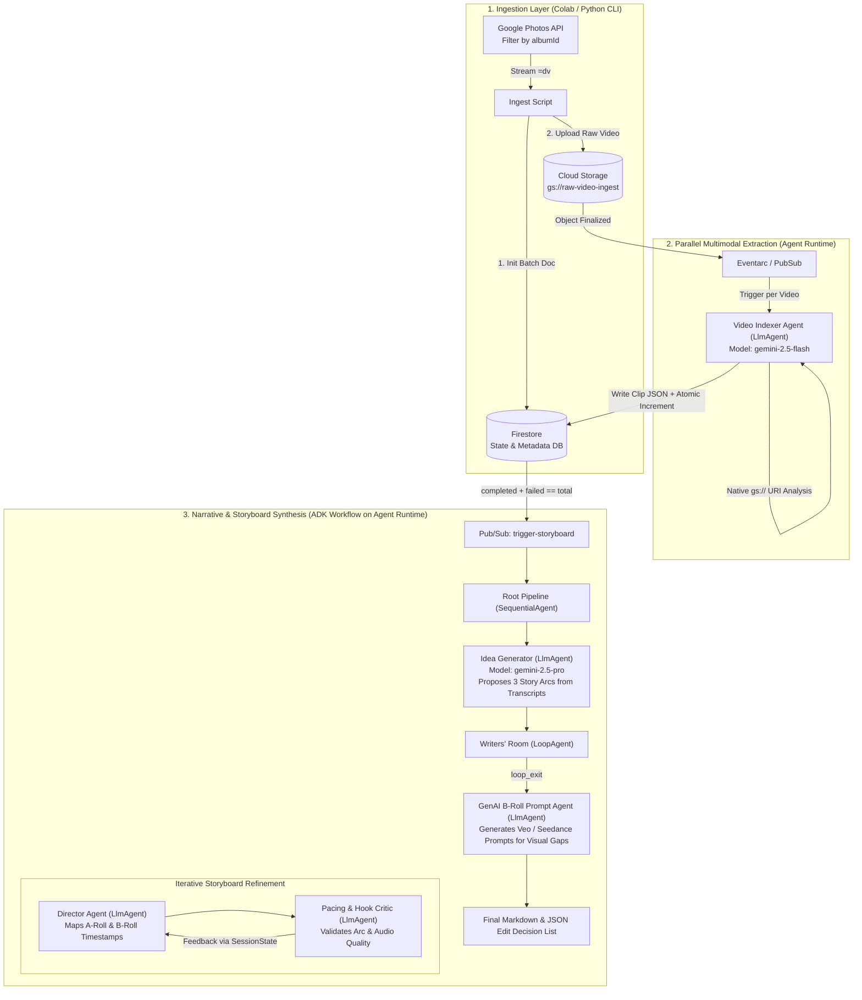

# Agentic Video Storyboarder & Production Pipeline

An automated, multimodal AI pipeline that ingests raw, unstructured video footage from Google Cloud Storage (GCS), extracts time-coded scene metadata and transcripts, autonomously ideates narrative arcs, and generates production-ready A-Roll/B-Roll storyboards with generative AI video prompts for missing visual coverage.

Built with **Google Agent Development Kit (ADK)**, **Vertex AI (Gemini 2.5 Pro & Flash)**, and deployed on **Gemini Enterprise Agent Platform (Agent Runtime)**.

---

## 🎯 Dual-Purpose Vision
* **Creator / Family Vlogs ("The Traveling T's"):** Turn 30+ minutes of raw, shaky family footage (e.g., zoo trips, reptile encounters) into cohesive 2–3 minute YouTube scripts with exact editing timestamps and synthetic B-roll prompts (e.g., generating prehistoric Megalodon clips to pair with fossil footage).

---

## 🏗️ High-Level Architecture

The system supports both **Event-Driven Ingestion** (via GCS + Eventarc + Firestore Scatter-Gather) and **Batch Album Ingestion** orchestrated via ADK on **Agent Runtime**.



---

## 🤖 Agent Hierarchy (Google ADK)

The core intelligence is structured using ADK's deterministic workflow primitives combined with Gemini 2.5 reasoning agents:

### 1. `video_indexer_agent` (`LlmAgent` - `gemini-2.5-flash`)

* **Role:** Assistant Editor.
* **Input:** A single `gs://` video URI.
* **Task:** Performs native multimodal analysis without manual frame/audio splitting. Extracts speaker diarization, verbatim dialogue transcripts, visual scene descriptions, audio quality scores, and A-roll/B-roll classification mapped to `[MM:SS]` timestamps.
* **Tools:** `save_clip_metadata_to_firestore`, `increment_job_counter`.

### 2. `storyboard_pipeline` (`SequentialAgent`)

Triggered once all videos in a batch finish indexing. Executes the following sub-agents in order:

* **`idea_generator_agent` (`LlmAgent` - `gemini-2.5-pro`):**
* **Task:** Reads all extracted clip JSONs from Firestore/SessionState. Identifies high-energy moments, thematic clusters, and natural climaxes (e.g., "Uncle Jimmy and the Caiman" or "Prehistoric Fossils") instead of relying on a human-supplied prompt. Outputs the strongest narrative arc into `state['selected_arc']`.


* **`writers_room` (`LoopAgent` - max 3 iterations):**
* **`director_agent` (`LlmAgent` - `gemini-2.5-pro`):** Drafts a time-coded script pairing clean A-roll voiceovers with engaging B-roll visual cutaways. Handles audio edge cases (e.g., boosting quiet speakers or spotlighting shy subjects in B-roll).
* **`critic_agent` (`LlmAgent` - `gemini-2.5-flash`):** Evaluates the draft for hook strength in the first 5 seconds, pacing, runtime targets (2–3 mins), and visual coverage. Calls `exit_loop` when quality thresholds are met, or appends revision notes to `state['critic_feedback']`.


* **`vfx_prompt_agent` (`LlmAgent` - `gemini-2.5-flash`):**
* **Task:** Scans the finalized storyboard for `[GEN_AI_BROLL_NEEDED]` tags (where speakers mention concepts lacking visual footage, such as a living Megalodon) and writes optimized text-to-video prompts for Veo / Seedance.


---

## 💾 Data Schemas (Firestore)

### Collection: `processing_jobs/{job_id}`

Tracks Scatter-Gather synchronization across asynchronous video indexing runs.

```json
{
  "job_id": "caiman_weekend_2026",
  "album_id": "ALBUM_ID_FROM_GOOGLE_PHOTOS",
  "total_videos": 14,
  "completed_videos": 13,
  "failed_videos": 1,
  "status": "SYNTHESIZING",
  "created_at": "2026-10-23T22:00:00Z"
}

```

### Sub-collection: `processing_jobs/{job_id}/clips/{clip_id}`

Output generated by `video_indexer_agent`.

```json
{
  "clip_id": "VID_20261018_142210.mp4",
  "gcs_uri": "gs://raw-video-ingest/caiman_weekend_2026/VID_20261018_142210.mp4",
  "duration_seconds": 142,
  "segments": [
    {
      "start_time": "00:12",
      "end_time": "00:28",
      "clip_type": "A_ROLL",
      "visual_description": "Grayson holding a large fossilized Megalodon tooth up to the lens.",
      "transcript": "Look how big this tooth is! Uncle Jimmy said Megalodon could eat a whale.",
      "speakers": ["Grayson"],
      "audio_clarity_score": 0.92,
      "excitement_score": 0.95,
      "tags": ["fossil", "megalodon", "grayson"]
    }
  ]
}

```

---

## 📁 Repository Structure

```text
├── ingest/
│   ├── photos_to_gcs.py          # Colab/CLI script: Google Photos API -> GCS + Firestore init
│   └── client_secret.json.example
├── agents/
│   ├── indexer_agent/            # Triggered per video upload
│   │   ├── __init__.py
│   │   ├── agent.py              # LlmAgent definition (gemini-2.5-flash)
│   │   └── tools.py              # Firestore atomic transaction & DLQ handlers
│   └── storyboard_agent/         # Triggered on batch completion
│       ├── __init__.py
│       ├── agent.py              # Root SequentialAgent, LoopAgent, and sub-agents
│       ├── prompts.py            # System instructions for Ideator, Director, Critic, VFX
│       └── tools.py              # Firestore clip fetcher & exit_loop tools
├── infra/
│   └── main.tf                   # Terraform for GCS, Firestore, Pub/Sub, Eventarc, IAM
├── requirements.txt              # google-adk, google-cloud-firestore, google-cloud-storage
└── README.md

```

---

## 🚀 Getting Started

### 1. Prerequisites & Installation

```bash
python -m venv .venv
source .venv/bin/activate
pip install google-adk google-cloud-firestore google-cloud-storage google-auth-oauthlib requests

```

### 2. Local Development & Debugging (ADK Web UI)

Test the Storyboard Multi-Agent workflow locally using the built-in ADK developer UI to inspect session state, event traces, and loop iterations:

```bash
adk web agents/storyboard_agent

```

### 3. Deploy to Gemini Enterprise Agent Platform (Agent Runtime)

Deploy the agents to managed Agent Runtime for production execution and observability:

```bash
adk deploy agent_runtime --project=$GOOGLE_CLOUD_PROJECT --region=us-central1 agents/indexer_agent
adk deploy agent_runtime --project=$GOOGLE_CLOUD_PROJECT --region=us-central1 agents/storyboard_agent
```